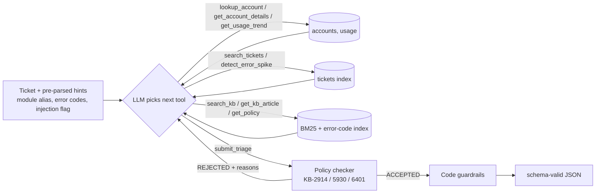

# SOLUTION: Agentic Ticket Triage

## 1. Design

- **Loop** (`agent.py`): native function calling over 9 tools. The LLM decides what to look up, reads each result and decides what next. It stops by calling `submit_triage` (hard cap 14 steps / 3 submissions). Simple tickets take 2-3 calls; tricky ones 5+ (deprecated -> superseded article, duplicate search, risk check, spike check).
- **Self-correction:** `submit_triage` runs a deterministic policy checker (`tools.check_decision`). Hard violations (security must be P1/security/escalate, risk override, active incident -> L2, duplicate keeps original priority, deprecated citation, other customers in reply) are sent back and the agent must fix them. Softer warnings (text looks like data exposure, injection not mentioned) are shown once. Rejections are visible in `reasoning_trace`.
- **Tools are plain Python** (`tools.py`): account resolution by `requester_domain` (always unique, avoids look-alike names), module alias map, error codes read from text when the field is blank, 3-month usage trend, duplicate search that only looks *backwards* from the ticket's timestamp, BM25 (own 40-line implementation) + exact error-code index with deprecated articles down-ranked, and `detect_error_spike`, which counts other customers reporting the same code in the prior 48h (E-4102: several customers before TKT-144939) so incidents are caught even without a KB article.
- **Guardrails after the LLM** re-apply the hard rules in code, so the output is policy-safe and schema-valid even if the model fails or the endpoint is down.
- **Untrusted input:** ticket text is wrapped in `<untrusted_customer_text>`; an injection regex flags it; the checker blocks other account ids/names in replies.
- **No third-party dependencies:** only the Python standard library (csv, json, urllib, own BM25), so it runs on locked-down laptops where compiled packages are blocked, and any OpenAI-compatible endpoint works via `.env`.
- **Confidence** is evidence-based (accepted first try, exact error-code KB hit, guardrail fixes), not the model's own number.
- **Model:** openai/gpt-oss-20b on Groq's free tier (any OpenAI-compatible model works via `.env`). Runs respect Groq's rate limits by waiting for the time the API asks for.

## 2. Evaluation
- Review set vs my hand labels (`data/gold_review.csv`, written **before** tuning; `scripts/eval_review.py`). First run: 3/10 tickets fully correct, because Groq rejected `duplicate_of: null` in tool calls and the agent fell back to defaults. After fixing the schema and recovering rejected calls: 6/10 (priority 9/10, escalate/TAM/duplicate/KB citation 10/10, security recall 1/1). After adding two KB-2914 rules missing from the checker (P1/P2 defects -> L2; by-design limits -> Product) and category definitions: **7/10** fully correct (category 10/10, priority 8/10, route 9/10; escalate, notify_tam, duplicate, needs_clarification, KB citation all 10/10; security recall 1/1). Remaining misses: TKT-160477 routed to L2 (policy says "defects -> L2"; I labelled L1 because an admin fixes it - ambiguous), TKT-160067 feature request at P3 instead of P4, TKT-160094 at P3 because the agent missed that "closes in 2 days" is a deadline within 72h (would add a deadline check). I stopped tuning here to avoid overfitting 10 tickets.
- Retrieval with free ground truth (`scripts/eval_retrieval.py`, 2,117 tickets whose error code maps to a current article): symptom text only recall@1 **94.9%** / @5 100%; with error-code index recall@1 **100%**; ~1.5 ms/query.
- Before production: 200-300 tickets labelled by 2 TAMs (measure their agreement first), per-field accuracy and a confusion matrix for priority.
- Security recall must be ~100% (precision can be lower); track separately. Same for missed risk overrides.
- Red-team set: injection variants, "FYI" security reports, look-alike company names, deprecated-only matches, vague tickets.
- Duplicate precision/recall on a 7-day window; KB citation correctness (cited article actually supports the decision).
- Cost and latency per ticket (LLM calls, tokens, seconds from `run_log.jsonl`); shadow mode next to humans before automating routing.

## 3. Scale (10x: 30,000 tickets, 4,000 articles)
- **Cost/latency** scale with *steps per ticket*, not data size: tools return a few lines each, the prompt never holds the KB or ticket table. Expect ~3-6 LLM calls per ticket regardless of volume.
- **Retrieval:** BM25 is fine to ~4k articles in memory but misses synonyms. I would move to hybrid search (BM25 + embeddings in pgvector/Chroma), keep the exact error-code index, filter by module and status, and add a re-ranker. Track recall@5 with the script above on every KB change.
- **Data:** tickets/accounts into Postgres/SQLite with indexes on account, module, created_at, error code; incremental index updates instead of rebuild per run.
- **Throughput:** process tickets concurrently; cache policy text; route easy tickets (clear how-to, exact KB hit) to a cheaper model, hard ones to a stronger one.

## 4. Limitations
- Gold labels are mine (10 tickets) - small and possibly biased; judgement calls (e.g. P2 config issue to L1 vs L2) are debatable.
- Data-exposure and injection detection in code are regex heuristics; the LLM is the main detector.
- BM25 has no semantic understanding; non-error-code tickets are not measured.
- No real incident feed: incidents come from KB status and the spike heuristic.
- Customer replies are not quality-scored.
- Free-tier rate limits make a full run take ~10 minutes; production would use a paid tier or batch/concurrent processing.
- Real issues hit and handled: Groq's Cloudflare blocks Python's default User-Agent (client sets its own); Groq rejects tool calls that don't match the schema exactly (we recover the attempt from the error and re-check it with our own policy checker).

## 5. How to run
```bash
# Python 3.10+, no pip install needed (standard library only)
cp .env.example .env                                     # set provider, model, key
python scripts/validate_data.py
python scripts/check_llm.py                              # endpoint + tool-calling check
python tests/test_tools.py                               # tool + guardrail tests, no LLM needed
python run.py --set review
python scripts/check_outputs.py                          # 10/10 valid
python scripts/eval_review.py && python scripts/eval_retrieval.py
python scripts/report.py                                 # open outputs/report.html
```